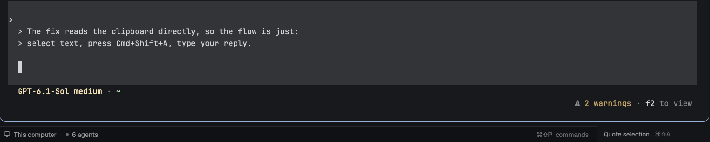

# Quote Reply for Herdr

This [Herdr](https://herdr.dev) mod lets you reply to one part of an agent's
output. Select text in a terminal and press ⌘⇧A. The selection lands in the
input as a quote, and you type your reply under it:

```
> the line you selected
> and the next one

your reply here
```

Nothing is sent until you press Enter.



## Install

Ask your agent:

> Add the Herdr mod at https://github.com/daniel7an/herdr-quote-reply

The agent follows [RECIPE.md](RECIPE.md). It copies `mods/quote-reply` into
`~/.config/herdr-app/mods/`, adds the ⌘⇧A key from `keys.json`, and puts a
"Quote selection" button at the right end of your status bar.

To install it yourself:

1. Copy `mods/quote-reply` into `~/.config/herdr-app/mods/`.
2. Add `"cmd-shift-a": "quote-reply.quote"` to the `terminal` section of
   `~/.config/herdr-app/keys.json`.
3. Add the `quote-reply` block to your layout's status bar, using the JSON in
   RECIPE.md. ⌘⇧A only works while that block is in the layout. The shipped
   `main` layout can't be edited, so clone it first.
4. Run `herdr-app check ~/.config/herdr-app/mods/quote-reply`.

## Notes

It only runs on macOS, because it checks the clipboard through `osascript`.

It quotes what's on the clipboard, which is your selection, because Herdr copies
text as soon as you select it. Pressing ⌘⇧A twice without selecting anything new
does nothing, so an old quote isn't pasted by accident.

## License

Apache-2.0, like Herdr.
