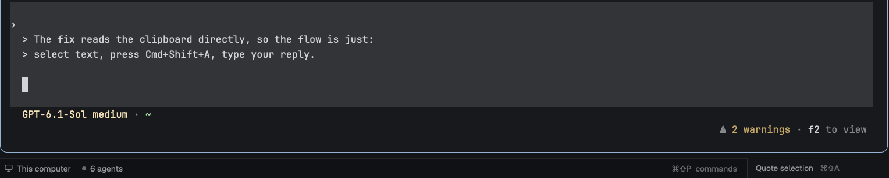

# Quote Reply

Quote Reply lets you answer one part of an agent's output. Select text in a
terminal and press ⌘⇧A. The selection is pasted into that terminal's input as a
Markdown quote, with each line starting with `> `, and the cursor waits on a
blank line below it. Type your reply and press Enter yourself. Nothing is sent
for you.



## What you see

A 210px block sits at the right end of the status bar, 28px tall, with a 1px
`border` line on its left. It reads "Quote selection" in `muted` 11.5px text,
followed by "⌘⇧A" in `dim`. It changes to "Quoting…" while it works and gets the
`hover` background under the pointer.

The pasted text starts with a blank line, then the selection with `> ` before
every line. Empty lines become a bare `>`. A blank line follows, and the cursor
sits on it.

When something goes wrong, a "Quote selection" toast says why: no terminal is
focused, nothing new was selected since the last quote, the selection is empty,
focus moved to another terminal while it worked, or the clipboard couldn't be
read.

## How it behaves

Press ⌘⇧A while a terminal has focus, or click the status bar block. The mod
takes the focused terminal (`focused().shown`, else `focused().terminal`) and
reads the clipboard, which already holds the selection because Herdr copies
text as soon as you select it. It wraps the text with `quoteBlock` and pastes
it with `terminal.paste`.

It refuses to quote the same clipboard twice. After each paste it saves macOS's
pasteboard change count, and the next ⌘⇧A needs a higher count, which means a
new selection. This keeps an old quote from being pasted again by accident.

It works in any terminal program, but it's meant for agent inputs such as
Claude Code and Codex, which accept a multi-line paste without sending it.

## Built from

There is one mod, `mods/quote-reply/`, with `mod.json` set to
`{ "place": "none" }`. Herdr functions used: `focused`, `run`, `exec`, `theme`,
`nextCommand` and `notify`, plus `cx.read_from_clipboard()`,
`cx.write_to_clipboard()` and `cx.timer.after()`.

1. The key arrives through `nextCommand()`. Bind it in the `terminal` section
   of `keys.json`: `"cmd-shift-a": "quote-reply.quote"` (see `keys.json` in
   this repo).
2. To read the clipboard's change count, it runs
   `/usr/bin/osascript -l JavaScript -e 'ObjC.import("AppKit"); String($.NSPasteboard.generalPasteboard.changeCount)'`.
   Only the count leaves the app, never the clipboard text.
3. `quoteBlock(text)` normalizes line endings, trims trailing whitespace, puts
   `> ` before each non-empty line (`>` on empty ones), and returns
   `"\n" + lines + "\n\n"`.
4. After `run("terminal.paste")` it waits 100ms and saves the new change count,
   since its own clipboard write raises it.
5. A `busy` flag ignores a second ⌘⇧A while one is still running.

To show the button, add a block to the right of the status bar's
`workspace-status` block in a layout you own:

```json
{ "id": "status-row", "type": "row", "size": { "px": 28 }, "children": [
  { "id": "status", "type": "block", "content": { "mod": "workspace-status" }, "size": { "weight": 1 } },
  { "id": "quote-reply", "type": "block", "content": { "mod": "quote-reply" }, "size": { "px": 210 } } ] }
```

Herdr's shipped `main` layout can't be edited, so clone it first
(`layout.clone {name: "main", as: "my-layout"}`). The block is also what makes
the key work: `<mod>.<command>` reaches only copies that are shown, so ⌘⇧A does
nothing in a layout without a `quote-reply` block.

## Watch out

It only works on macOS, because the change count comes from `osascript` and
`NSPasteboard`.

It depends on Herdr copying a selection the moment it's made. A first version
waited for the clipboard to change after the key press, and it always failed,
because the text was already on the clipboard.

Write `mod.json` before `main.js`. The first time Herdr sees a new mod folder,
it docks the mod into the shown layout, unless `mod.json` already says
`"place": "none"`.

If you copy something else between selecting and pressing ⌘⇧A, the mod quotes
whatever is on the clipboard.

Some programs trim trailing whitespace from a paste, which drops the blank line
after the quote. Claude Code keeps it.

## Done when

1. `herdr-app check ~/.config/herdr-app/mods/quote-reply` passes and
   `herdr-app status` shows no errors.
2. The status bar shows "Quote selection ⌘⇧A" at its right end.
3. Selecting two lines of a Claude Code reply and pressing ⌘⇧A puts a blank
   line, the two lines with `> ` in front, and a blank line into the input,
   with the cursor on the last line. Nothing is sent.
4. Pressing ⌘⇧A again without a new selection shows "Nothing new selected
   since the last quote" and pastes nothing.
5. Pressing ⌘⇧A with no terminal focused shows "Focus a terminal, select text,
   then press ⌘⇧A."
